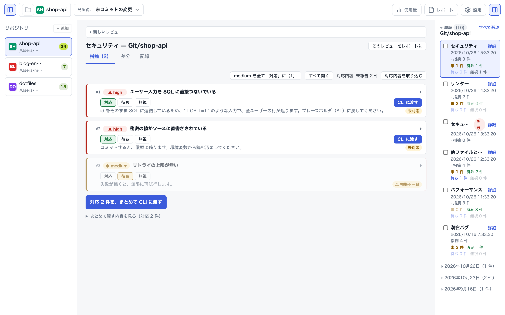
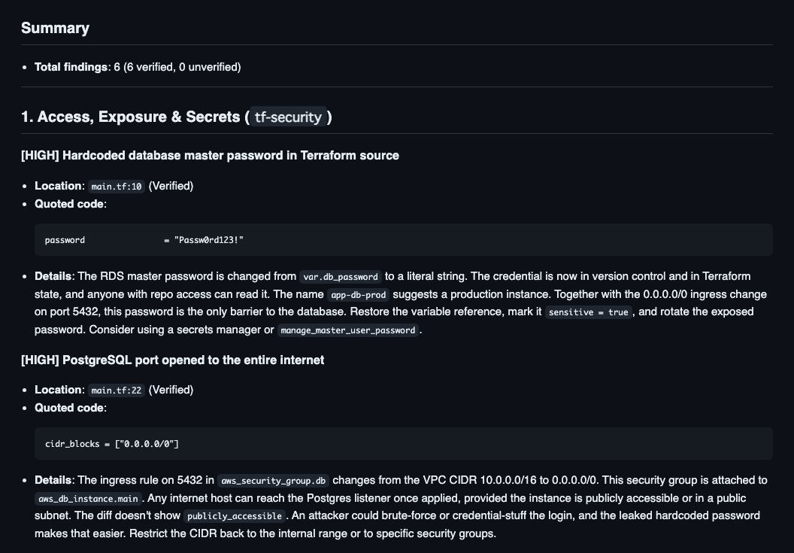

<p align="center"></p>

# MrCodeReview

**コミットする前に、紛れ込んだバグを潰す。**  
コミット前の未コミット変更を、観点（バグ・例外処理・セキュリティ・性能・テスト・整合性・Terraform 5 観点・文書 3 観点）ごとに AI にレビューさせ、引用行の厳密照合（ハルシネーション検証）を行うオープンソース開発ツールです。

**Mac デスクトップアプリ（GUI）** と **ターミナル用 CLI（`mrcr`）** の両方を、制限なし・完全無料で提供しています。

[English](README.md)

<p align="center">
  
</p>

---

## 特徴

- **GUI も CLI も好みに合わせて使える**: どちらも MIT ライセンス、制限なしにフル機能。履歴や仕分けデータは同じローカル SQLite DB でシームレスに共有されます。
- **自分の API キーで直接（BYOK）**: 中継サーバーなし。手元の環境変数や macOS キーチェーンから Anthropic API を直接呼び出します（完全ローカル完結・プライバシー安全）。
- **観点を混ぜない（1回1実行の原則）**: 1 つのプロンプトに複数の観点を混ぜず、観点ごとに集中して高精度にレビュー。結果は 1 つのレポートに束ねます。
- **でっち上げ（ハルシネーション）の即時検出**: モデルが引用した行が実際の差分に存在するかを文字列照合し、「根拠あり」「⚠️ 根拠不一致」を自動判定します。
- **コーディングエージェントとの完全連携**: レビュー結果を `.mrcodereview/out/review.md`（または JSON）に自動出力。`Claude Code` や `agy` にそのまま読ませて自動修正ループを回せます。
- **Pure Rust & Tauri v2 実装**: 超軽量・高速。Apple Silicon ネイティブ対応（Developer ID 署名 ＋ Apple 公証済み）。

---

## インストール

### 1. Mac デスクトップアプリ（GUI）

公式サイトまたは GitHub Releases から DMG をダウンロードしてインストールできます。

- **[公式サイトからダウンロード（mrktools.app）](https://mrktools.app/mrcodereview/download/)**
- **[GitHub Releases からダウンロード](https://github.com/MR-TABATA/MrCodeReview/releases)**

> **動作環境**: macOS 13.0 以降（Apple Silicon）

### 2. CLI ツール (`mrcr`)

#### Homebrew (macOS)

```bash
brew install mr-tabata/tap/mrcr
```

#### Cargo でビルド

```bash
git clone https://github.com/MR-TABATA/MrCodeReview.git
cd MrCodeReview
cargo install --path crates/mrcr
```

---

## 使い方

### 1. API キーの設定

中継サーバーはありません。手元の API キーで直接 LLM を呼び出します。

- **デスクトップアプリ**: 画面右上の「設定（⌘,）」から Anthropic API キーを入力（macOS キーチェーンに安全に保存されます）。
- **CLI**: 環境変数に設定します。
  ```bash
  export ANTHROPIC_API_KEY="sk-ant-..."
  ```

---

### 2. デスクトップアプリでの操作

1. アプリを起動し、左サイドバーに Git リポジトリを追加（または選択）します。
2. 上部の観点バー（`潜在バグ`、`セキュリティ` など）を選び、**「レビュー実行」** を押します。
3. 出てきた指摘を「対応」「保留」「却下」に仕分けます。
4. **「CLI に渡す」** ボタンを押すと、Claude Code や agy に渡すプロンプトと Handoff ファイルが自動生成されます。

---

### 3. CLI (`mrcr`) での操作

```bash
# 未コミットの変更を「潜在バグ」観点でレビュー（既定）
mrcr review

# 複数観点をカンマ区切りで実行（バグとセキュリティ）
mrcr review -r bugs,security

# 全観点を一括実行（組み込み＋`.mrcodereview/recipes/` に置いた独自のレシピ）
mrcr review --all

# 結果を標準出力（stdout）に出す
mrcr review -r bugs --stdout

# JSON 形式で出力（CI / スクリプト用）
mrcr review -r bugs -f json --stdout

# 差分の比較元を指定（例: HEAD~1 からの変更）
mrcr review -b HEAD~1

# 利用可能な観点一覧を表示
mrcr recipes
```

---

## CLI の実行例

意図的に危ない変更を入れたデモの Terraform（DB パスワードの直書き、5432 番ポートの `0.0.0.0/0` への開放、削除保護と最終スナップショットの無効化、DB の identifier の変更）をレビューした例です。

```bash
mrcr review -r tf-security,tf-replace -l en
```



指摘ごとに、差分からの引用行が付きます。引用行が実際の差分にあれば `Verified`（根拠あり）、なければ `Unverified evidence`（根拠不一致）と区別されます。

---

## レシピ（レビュー観点）一覧

レシピは、**1 つの観点だけ**を見るプロンプトです。`-r <id>[,<id>…]` で選び、`--all` で全部を実行します。
差分（観点によっては、差分の外の関連コードも）から判断し、指摘ごとに実在する行の引用を求めます。

### 汎用コード（6 観点）

| ID | 見るもの |
|---|---|
| `bugs` | 今は動くが、特定の入力で壊れるコード。1 つのずれ、null・空の扱い、単位・符号・桁あふれ、条件式の誤り、状態の更新漏れ、非同期の競合、閉じ忘れ、文字コード・タイムゾーン、コピーの直し忘れ |
| `errors` | 失敗が握りつぶされる・成功扱いになる・追えなくなるコード。空の `catch`、エラー時の代替値、戻り値・終了コードの未確認、見えない非同期の失敗、原因情報の破棄、`unwrap`、タイムアウト・再試行の上限なし |
| `security` | インジェクション（SQL・コマンド・パス・XSS）、認証・認可の抜け、ハードコードされた秘密、未検証の入力（SSRF・デシリアライズ）、暗号の誤用 |
| `performance` | データが増えると遅くなる・重くなるコード。計算量、N+1・ループ内 I/O、直列の非同期、不要なコピー、メモリの増え続け、UI スレッドのブロック、正規表現のバックトラック、索引の不足 |
| `tests` | 差分内のテストで確かめられていない挙動の変更。未テストの分岐・失敗系、古いままのテスト、弱い・自明に通る検証、時刻・乱数・`sleep` に頼る壊れやすいテスト、回帰テストのない修正 |
| `consistency` | 変えていないコードとの矛盾。シグネチャ・戻り値を変えたのに古い呼び出し元、改名したのに残る参照、対の定義の片側だけの更新。差分の外の関連コードも使う |

### Terraform / HCL（5 観点）

| ID | 見るもの |
|---|---|
| `tf-state` | アドレスと state の対応。`count`/`for_each` の切り替え・キー変更、`moved` のない改名、`import`/`removed` の誤り |
| `tf-replace` | 意図しない再作成・データ消失。再作成を強いる属性変更、`lifecycle` の誤用、適用順による停止、保護のないデータ保持リソースの削除 |
| `tf-repro` | 環境や時間で結果が変わる点。バージョン制約の欠落・緩さ、ロックファイルのずれ、メジャー更新、`timestamp()`・「最新」の取得 |
| `tf-security` | 広すぎる IAM、外部公開（`0.0.0.0/0`・公開バケット）、暗号化・ログの無効化、ハードコード・`sensitive` 抜けの秘密 |
| `tf-refs` | variable / output / module の参照が、ファイルや環境をまたいで繋がっているか。差分の外の関連ファイルも使う |

### 文書（3 観点）

設計メモ・仕様書・README 向けです。差分に `.md`・`.mdx`・`.txt`・`.rst` があるときに自動判定されます。

| ID | 見るもの |
|---|---|
| `doc-claims` | 出典・測定・確認の方法がないまま書かれた、数字・結果・言い切り（「必ず」「無い」「無関係」など） |
| `doc-reality`（実験的） | 確かめた形跡がないまま事実として書かれた、外部のコマンド・パッケージ・API の名前、バージョン、料金、制限 |
| `doc-steps` | 読み手が行動に移れない箇所。前提の抜け、「後で決める」を決まったものとして使う、理由や戻し方のない決定、食い違う状態の記述 |

### カスタマイズ（独自レシピの追加）

リポジトリの `.mrcodereview/recipes/<id>.md` に Markdown を置くだけで自由に拡張できます。

- 組み込みと**同じ ID** → 組み込みを**上書き**
- **新しい ID** → 独自の観点を**追加**

組み込みのプロンプトは [`recipes/`](recipes)（日本語。既定）と [`recipes/en/`](recipes/en)（英語。`--lang en`）にあります。

---

## コーディングエージェント（Claude Code / agy）連携

### 1. シンプルな連携
```bash
# レビューを実行（.mrcodereview/out/review.md が生成される）
mrcr review -r bugs

# エージェントにそのまま直させる
claude ".mrcodereview/out/review.md の指摘を確認してコードを修正して"
```

### 2. 人間が仕分けた指摘だけを直させる（`mrcr handoff`）
1. デスクトップアプリ（または CLI）でレビューし、直してほしい指摘だけを **「対応」** に仕分けます。
2. エージェントが未対応の指摘を取得して修正します。
   ```bash
   mrcr handoff get             # 直す指摘をまとめて取得
   mrcr handoff get --json      # 構造化した JSON で取得
   ```
3. エージェントが結果を報告します。
   ```bash
   mrcr handoff report <review_id> 1,2 --did --text "何を直したか"
   ```
4. 報告はデスクトップアプリの画面にリアルタイムで反映されます。

> Claude Code 用のスキルを [`skills/mrcr-handoff`](skills/mrcr-handoff) に同梱しています。

---

## ライセンス

MIT License © 2026 Hitoshi TABATA
