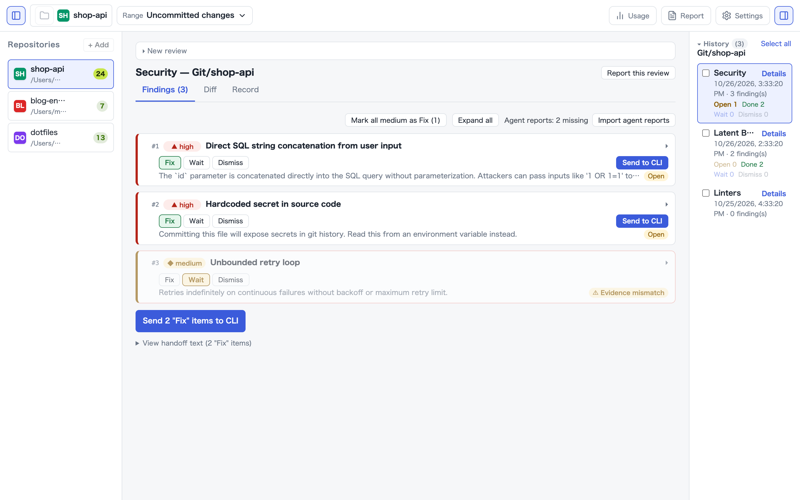

<p align="center"></p>

# MrCodeReview

**Catch the bugs that slip in, before you commit.**  
An open-source AI code review tool that inspects your uncommitted git changes aspect-by-aspect (bugs, errors, security, performance, tests, consistency, Terraform ×5, documents ×3) and verifies citation accuracy to detect hallucinations.

Provides both a visual **Mac desktop app (GUI)** and a command-line **CLI tool (`mrcr`)**, 100% free with no feature restrictions.

[日本語](README.ja.md)

<p align="center">
  
</p>

---

## Features

- **GUI or CLI, whatever fits your workflow**: Both licensed under MIT with all features fully unlocked. Review history and triage data are seamlessly shared via a local SQLite database.
- **Direct BYOK (Bring Your Own Key)**: Direct communication with the Anthropic API using your local environment variables or macOS Keychain. No middleman relay servers (100% local and privacy-safe).
- **Isolated Aspect Reviews**: Instead of generic code reviews, each aspect is executed independently for maximum focus and depth, then bundled into a single report.
- **Hallucination Detection**: Strictly verifies quoted lines against actual git diffs, automatically labeling them `Evidence found` or `⚠️ Evidence mismatch`.
- **Coding Agent Handoff**: Automatically outputs findings to `.mrcodereview/out/review.md` (or structured JSON). Hand off directly to coding agents like `Claude Code` or `agy` for automated fix loops.
- **Pure Rust & Tauri v2**: Ultra-lightweight and fast. Native Apple Silicon support (Developer ID signed & Apple notarized).

---

## Installation

### 1. Mac Desktop App (GUI)

Download the DMG from the official site or GitHub Releases:

- **[Download from Official Site (mrktools.app)](https://mrktools.app/en/mrcodereview/download/)**
- **[Download from GitHub Releases](https://github.com/MR-TABATA/MrCodeReview/releases)**

> **Requirements**: macOS 13.0 or later (Apple Silicon)

### 2. CLI Tool (`mrcr`)

#### Homebrew (macOS)

```bash
brew install mr-tabata/tap/mrcr
```

#### Build with Cargo

```bash
git clone https://github.com/MR-TABATA/MrCodeReview.git
cd MrCodeReview
cargo install --path crates/mrcr
```

---

## Usage

### 1. Configure API Key

No relay servers. Your machine communicates directly with the LLM API:

- **Desktop App**: Open Settings (⌘,) from the top right and enter your Anthropic API key (safely stored in macOS Keychain).
- **CLI**: Export via environment variable:
  ```bash
  export ANTHROPIC_API_KEY="sk-ant-..."
  ```

---

### 2. Desktop App Workflow

1. Launch the app and add your Git repository from the left sidebar.
2. Select review angles (e.g., `Latent Bugs`, `Security`) from the top bar and click **"Run Review"**.
3. Triage the findings into **Fix**, **Wait**, or **Dismiss**.
4. Click **"Send to CLI"** to generate the agent hand-off prompt and Markdown file.

---

### 3. CLI (`mrcr`) Commands

```bash
# Review uncommitted changes for latent bugs (default)
mrcr review

# Run multiple angles (comma-separated)
mrcr review -r bugs,security

# Run all angles (built-in + custom recipes in .mrcodereview/recipes/)
mrcr review --all

# Output to stdout
mrcr review -r bugs --stdout

# Output in JSON format (for CI/CD or scripts)
mrcr review -r bugs -f json --stdout

# Specify comparison base (e.g. changes since HEAD~1)
mrcr review -b HEAD~1

# List available review angles
mrcr recipes
```

---

## CLI Output Example

Example of reviewing a deliberately vulnerable Terraform file (hardcoded DB password, port 5432 open to `0.0.0.0/0`, deletion protection disabled):

```bash
mrcr review -r tf-security,tf-replace -l en
```


Each finding cites the exact line in the diff, verified against actual changes (`Verified` vs `Unverified evidence`).

---

## Review Angles (Recipes) Catalog

Each recipe focuses on **one specific concern**. Select with `-r <id>` or run all with `--all`.

### Code (6 angles)

| ID | Focus |
|---|---|
| `bugs` | Code that works now but breaks on specific input: off-by-one, null / empty handling, units/signs, condition bugs, state update omissions, async races, unclosed resources, timezone/encoding issues |
| `errors` | Swallowed or untraceable failures: empty `catch`, fallback values on error, unchecked return codes, lost root causes, `unwrap`, missing retry limits |
| `security` | Injections (SQL, command, path, XSS), missing auth/authz, hardcoded secrets, unvalidated input (SSRF, deserialization), crypto misuse |
| `performance` | Code that degrades under scale: algorithmic complexity, N+1 / loop I/O, serial async, redundant copies, memory growth, UI thread blocking |
| `tests` | Untested behavioral changes: missing branch/failure tests, stale assertions, flaky tests depending on time/sleep, fixes without regression tests |
| `consistency` | Inconsistencies with untouched code: stale callers of modified signatures, renamed symbols with leftover references. Inspects related code outside diff |

### Terraform / HCL (5 angles)

| ID | Focus |
|---|---|
| `tf-state` | Resource address to state mapping: `count`/`for_each` conversions, key renames without `moved`, faulty `import`/`removed` |
| `tf-replace` | Unintended recreation / data loss: attributes forcing recreation, misused `lifecycle`, apply-order downtime, deleting stateful resources |
| `tf-repro` | Environmental / temporal instability: loose version constraints, lockfile drift, major bumps, `timestamp()` calls |
| `tf-security` | Overly permissive IAM, open access (`0.0.0.0/0`, public buckets), disabled encryption/logging, unmasked secrets |
| `tf-refs` | Cross-file/cross-environment variable, output, and module link validity |

### Documents (3 angles)

Automatically evaluated when `.md`, `.mdx`, `.txt`, or `.rst` files are in the diff.

| ID | Focus |
|---|---|
| `doc-claims` | Unsubstantiated numbers, claims, or absolutes ("always", "none", "unrelated") |
| `doc-reality` (Experimental) | Unverified factual assertions regarding external commands, package names, versions, pricing, or limits |
| `doc-steps` | Gaps preventing reader action: missing preconditions, unmade decisions treated as final, missing rationale |

### Customization

Add custom recipes by creating Markdown files in `.mrcodereview/recipes/<id>.md`:

- **Same ID**: Overrides built-in recipe.
- **New ID**: Adds a custom review angle.

Built-in prompt templates can be inspected in [`recipes/`](recipes) (Japanese) and [`recipes/en/`](recipes/en) (English).

---

## Coding Agent (Claude Code / agy) Integration

### 1. Simple Workflow
```bash
# 1. Run review (.mrcodereview/out/review.md generated)
mrcr review -r bugs

# 2. Instruct agent to fix
claude "Read .mrcodereview/out/review.md and fix the findings"
```

### 2. Human-in-the-Loop Triage (`mrcr handoff`)
1. Review findings in the desktop app (or CLI) and mark target issues as **Fix**.
2. Let the agent fetch only the triaged items:
   ```bash
   mrcr handoff get             # Fetch all items marked Fix
   mrcr handoff get --json      # Fetch structured JSON
   ```
3. Agent applies changes and reports back:
   ```bash
   mrcr handoff report <review_id> 1,2 --did --text "Fixed null check"
   ```
4. Status and notes update in real-time in the desktop app.

> Claude Code custom skill available in [`skills/mrcr-handoff`](skills/mrcr-handoff).

---

## License

MIT License © 2026 Hitoshi TABATA
