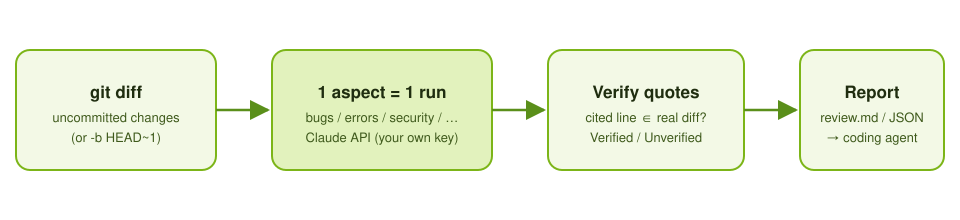
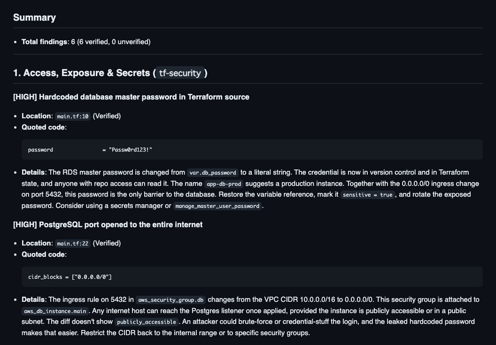

<p align="center"></p>

# MrCodeReview CLI (`mrcr`)

**Catch the bugs that slip in, before you commit.**  
An open-source CLI tool that reviews your uncommitted git changes aspect-by-aspect (bugs, errors, security, performance, tests, consistency, Terraform ×5) and verifies quotation accuracy to detect hallucinations.

[日本語](README.ja.md)



---

## Features

- **Direct BYOK (Bring Your Own Key)**: Direct calls to Anthropic API using `ANTHROPIC_API_KEY`. No intermediate proxy servers.
- **Isolated Aspect Reviews**: Instead of generic code reviews, each aspect is executed independently for maximum focus and depth, then bundled into a single report.
- **Hallucination Detection**: Strictly verifies cited lines against actual git diffs, distinguishing between `Verified` and `⚠️ Unverified evidence`.
- **Coding Agent Handoff**: Automatically outputs review findings to `.mrcodereview/out/review.md` (or JSON). Read it directly with agents like `agy` or `Claude Code` for automated fix loops.
- **Cross-Platform**: Pure Rust. Runs on macOS and Linux (CI/CD environments like GitHub Actions).
- **Shared History with Desktop App**: On macOS, reviews are recorded to the local SQLite database shared with the desktop GUI app (MrkCodeReview).

---

## Installation

### Homebrew (macOS)

```bash
brew install mr-tabata/tap/mrcr
```

### Cargo

```bash
cargo install --path crates/mrcr
```

---

## Usage

```bash
export ANTHROPIC_API_KEY="sk-ant-..."

# Review uncommitted changes for bugs (default)
mrcr review

# Multiple aspects (comma-separated)
mrcr review -r bugs,security

# Run all built-in aspects
mrcr review --all

# Output to stdout
mrcr review -r bugs --stdout

# Output as JSON
mrcr review -r bugs -f json --stdout

# Specify diff base
mrcr review -b HEAD~1
```

### List available recipes

```bash
mrcr recipes
```

---

## Example

A demo Terraform change (hardcoded DB password, port 5432 opened to `0.0.0.0/0`, deletion protection and final snapshot turned off, DB identifier renamed) reviewed with:

```bash
mrcr review -r tf-security,tf-replace -l en
```



Every finding quotes a line from the diff. `Verified` means the quoted line really exists in the diff; otherwise the finding is flagged `Unverified evidence`. The image shows the summary and the first two of six findings. The diff is a made-up demo, not real code.

---

## Recipes (review aspects)

Each recipe is a prompt that looks at **one aspect only**. Pick them with `-r <id>[,<id>…]`, or run them all with `--all`.
Recipes judge from the diff (and, for some, related code outside it) and must cite a real line for every finding.

### General

| ID | Looks for |
|---|---|
| `bugs` | Code that works now but breaks on specific input: off-by-one, null/empty handling, unit/sign/overflow, wrong conditions, missed state updates, async races, unclosed resources, encoding/timezone, copy-paste slips |
| `errors` | Failures that are swallowed, treated as success or made untraceable: empty `catch`, fallback values on error, unchecked return codes, invisible async failures, lost root cause, `unwrap` on I/O, no timeout/retry limit |
| `security` | Injection (SQL/command/path/XSS), auth bypass, hardcoded secrets, unvalidated input (SSRF, deserialization), crypto misuse |
| `performance` | Slowdowns as data grows: bad complexity, N+1 and I/O in loops, serialized async work, needless copying, unbounded memory, blocking the UI thread, regex backtracking, missing indexes |
| `tests` | Changed behavior not covered by tests in the diff: untested branches/error paths, stale tests, weak or tautological assertions, brittle (time/random/sleep) tests, bug fixes without regression tests |
| `consistency` | Changes that contradict the code left untouched: signature/return changes with outdated callers, renamed fields still used, one-sided updates of paired definitions, dangling references. Uses related code outside the diff |

### Terraform / HCL

| ID | Looks for |
|---|---|
| `tf-state` | Address ↔ state mapping: `count`/`for_each` switches and key changes, renames without `moved`, `import`/`removed` mistakes |
| `tf-replace` | Unintended recreation or data loss: attributes that force replacement, misused `lifecycle`, apply-order downtime, deleting data-bearing resources without protection |
| `tf-repro` | Results that differ across environments/time: missing or loose version constraints, lock-file drift, major bumps, `timestamp()`/"latest" lookups |
| `tf-security` | Overly broad IAM, public exposure (`0.0.0.0/0`, public buckets), disabled encryption/logging, hardcoded or non-`sensitive` secrets |
| `tf-refs` | Variable / output / module references that no longer connect across files and environments. Uses related files outside the diff |

Terraform recipes never claim to have inspected `terraform plan`, state or provider schemas. They judge from the diff only.

### Customize

Put a Markdown file at `.mrcodereview/recipes/<id>.md` in your repository:

- Same ID as a built-in recipe → **overrides** it (shown as `repo` in `mrcr recipes`).
- New ID → **adds** your own aspect.

The built-in prompts are in [`recipes/en/`](recipes/en) (English) and [`recipes/`](recipes) (Japanese, `--lang ja`, the default).

---

## License

MIT License
